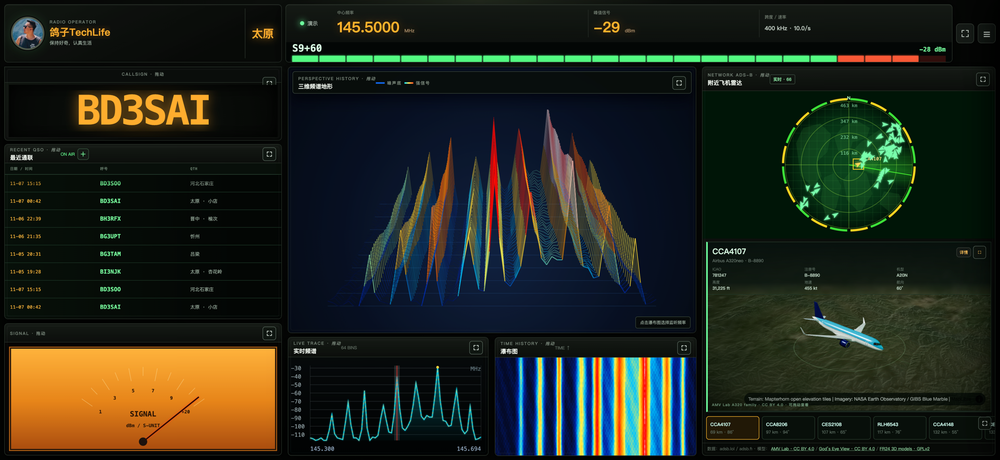

# SpectrumLink v3.7.7

把泉盛 UV-K1 / K1(8) 的 64 点 RSSI 扫描结果，变成适合横屏副显示器长期展示的本地无线电仪表台。

SpectrumLink 由两部分组成：安装到 F4HWN Labs v6.3.0 的只接收应用，以及运行在电脑上的本地网页。K1 负责顺序扫描，电脑负责绘制实时频谱、SDR 风格瀑布图、三维历史、机械/数字 S 表和独立的网络 ADS-B 飞机雷达。

> Designed by [鸽子TechLife](https://v.douyin.com/llSXBPzpKzI/) · Website [鸽子窝](https://www.lishuangtong.com) · Version `v3.7.7`



## 主要功能

- UV-K1/K1(8) 原生 USB-C + Web Serial 连接，64 点 RSSI 扫描。
- 400 kHz、800 kHz、1.6 MHz、3.2 MHz 四档扫描跨度。
- 实时频谱、密集瀑布图、三维频谱历史、标准 S 表和 RF 活动提示。
- 模块拖动、单模块全屏、浏览器全屏、1024×768 与宽屏自适应。
- 呼号、网名、头像、城市、Slogan、最近通联和多语言界面。
- 太原默认坐标附近的网络 ADS-B 雷达、真实机型 GLB、四镜头飞行动画与开源地形。
- 所有个性化和通联记录只保存在浏览器本地存储中。

## 先说明能力边界

SpectrumLink 显示的是 K1 对 64 个频点依次测得的 RSSI，不提供 I/Q 宽带采样，也不提供数字音频流，因此它不是 RTL-SDR、Airspy 或 SDR++ 的替代品。快速信号可能在两个采样点之间被漏过，瀑布图的细腻程度也受 64 点和扫描速度限制。

信号条和 S 值表示射频场强，不表示对方声音大小。没有独立音频采集设备时，网页不能从 RSSI 反推出语音音量或播放通话声音。

ADS-B 飞机数据来自网络服务，与 K1 接收链路完全独立。无公开实时数据时页面会如实显示不可用或 0 架，不会生成模拟飞机冒充实时目标。

## 环境要求

- 泉盛 UV-K1 / UV-K1(8)
- F4HWN Labs v6.3.0
- K1 原生 USB-C 数据线
- Node.js 20 或更高版本
- 桌面版 Chrome 或 Edge（Web Serial；Safari/Firefox 不支持）
- macOS 为当前主要实测环境

## 快速启动

```bash
npm ci
npm run serve
```

然后用 Chrome 或 Edge 打开 `http://127.0.0.1:8765`。macOS 也可以直接双击 `start.command`。

不连接电台时，可在右上角菜单中启用“演示”检查界面。连接实机、安装应用、备份与恢复步骤见[中文安装与实机测试指南](docs/install-and-test-zh.md)。

## 构建 K1 应用

```bash
npm run build:app
bash scripts/verify-dist.sh
```

构建脚本会下载固定版本并校验 SHA-256 的 F4HWN v6.3.0 源码，然后生成 `dist/SpectrumLink.app`。编译产物不进入 Git 历史；正式版本请从 GitHub Releases 下载。

在 UV Studio 的“应用”页面把 `.app` 安装到空闲槽位。运行 SpectrumLink 时会独占 USB 串口，UV Studio、K5Viewer 与本网页不能同时连接同一个 K1。

## 开发与测试

```bash
npm test
```

测试覆盖协议解析、串口生命周期、RSSI/信号检测、频谱与瀑布绘制逻辑、布局、多语言、ADS-B 代理、飞机模型选择、地形和发布包校验。提交前请同时阅读[贡献指南](CONTRIBUTING.md)和[安全政策](SECURITY.md)。

## 网络数据与隐私

本地服务会按功能需要访问：

- `adsb.lol`、`adsb.fi`：公开 ADS-B 位置；
- ADSBDB：机型、注册号与航线资料；
- Mapterhorn、NASA GIBS：开源高程与卫星影像；
- 三个开源飞机模型仓库：按机型加载 GLB。

本项目没有账号系统或云端数据库。头像、呼号、QTH、布局和最近通联只写入当前浏览器的 localStorage；网络服务仍可能按各自政策记录常规访问日志。

## 无线电与设备安全

- SpectrumLink 应用不调用发射接口，PTT 在应用内被忽略。
- 刷写第三方固件或应用始终有设备风险；先备份配置、校准和频率表。
- 只能在当地法规、业余无线电执照及频率使用规则允许的范围内操作设备。
- 本项目显示值不是经过计量认证的实验室测量结果。

## 开源许可证

SpectrumLink 原创代码采用 [GNU GPL v2 或更高版本](LICENSE)。第三方固件、库、飞机模型和地图数据保留各自许可证；完整来源、许可证与署名见 [NOTICE](NOTICE) 以及 `web/assets/licenses/`、`web/vendor/maplibre/LICENSE.txt`。

GPL 不代表所有第三方素材都自动改为 GPL。二次发布时必须同时遵守对应模型、地图和上游固件的许可证与署名要求。

## 参与项目

- Bug 与功能建议：使用 GitHub Issues 模板。
- 代码贡献：阅读 [CONTRIBUTING.md](CONTRIBUTING.md) 后提交 Pull Request。
- 安全问题：不要公开发 Issue，请按 [SECURITY.md](SECURITY.md) 私下报告。

作者：[鸽子TechLife](https://v.douyin.com/llSXBPzpKzI/) · 网站：[www.lishuangtong.com](https://www.lishuangtong.com)
